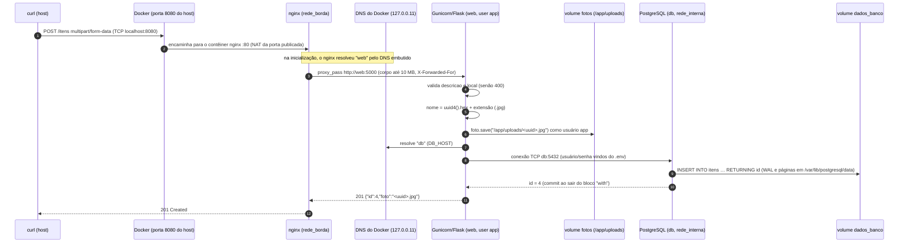
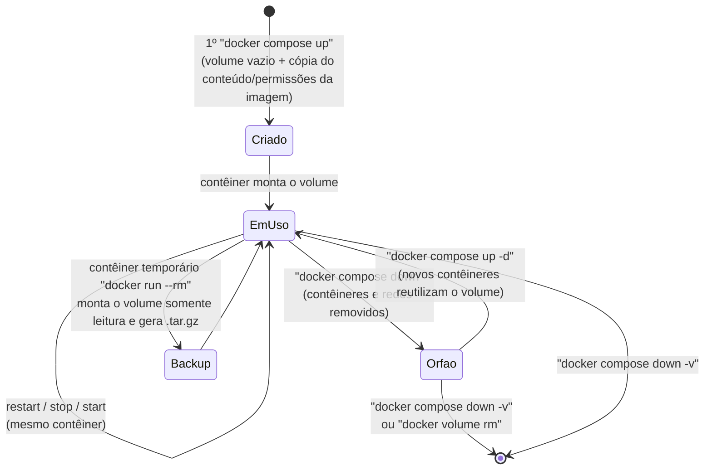

# Relatório técnico: Achados & Perdidos em contêineres (A3)

Este documento explica **como e por que** cada peça do ambiente funciona, para que a próxima equipe
possa operá-lo e migrá-lo para a nuvem sem precisar adivinhar. As referências `[ev NN]` apontam para os
arquivos de [`docs/evidencias/`](evidencias/README.md).

Sumário: [(a) Dockerfile](#a-dockerfile-da-aplicação-web) · [(b) docker-compose.yml](#b-docker-composeyml-bloco-a-bloco) ·
[(c) Caminho de um POST /itens](#c-caminho-completo-de-um-post-itens-com-foto) · [(d) Ciclo de vida dos volumes](#d-ciclo-de-vida-dos-volumes) ·
[Decisões e desvios](#decisões-de-arquitetura-e-desvios-do-enunciado) · [Limitações conhecidas](#limitações-conhecidas-e-recomendações)

---

## Antes de começar: o que o `app.py` exige do ambiente

A leitura do código fornecido (que não foi alterado) definiu boa parte da configuração:

| Pergunta | Resposta no `app.py` | Consequência no ambiente |
|----------|----------------------|--------------------------|
| Onde as fotos são gravadas? | `UPLOAD_DIR = os.getenv("UPLOAD_DIR", "/app/uploads")` | O volume `fotos` é montado em `/app/uploads`, e esse diretório precisa pertencer ao usuário do processo. |
| Qual host de banco por padrão? | `os.getenv('DB_HOST', 'db')` | O serviço do PostgreSQL **precisa** se chamar `db` (mesmo assim, `DB_HOST: db` é passado explicitamente). |
| Quais variáveis não têm padrão? | `DB_NAME`, `DB_USER`, `DB_PASSWORD` | Sem elas a conexão falha, por isso o Compose as preenche a partir das mesmas chaves `POSTGRES_*` do `.env`. |
| Em que porta escutar? | O módulo só cria `app`; quem escuta é o Gunicorn | `gunicorn --bind 0.0.0.0:5000 app:app`. |
| Como `/estatisticas` conta as fotos? | `len(os.listdir(UPLOAD_DIR))` | Conta qualquer arquivo no volume, então nada além das fotos deve ser gravado ali. |

---

## (a) Dockerfile da aplicação web

Arquivo: [`app/Dockerfile`](../app/Dockerfile)

| # | Instrução | O que faz | Por que está aqui (e nesta posição) |
|---|-----------|-----------|-------------------------------------|
| 1 | `FROM python:3.12-slim` | Usa a imagem oficial do Python 3.12 sobre Debian *slim*. | É oficial (mantida e com correções de segurança) e enxuta: tem só o necessário para rodar Python. A `slim` é preferível à `alpine` aqui porque as *wheels* binárias do `psycopg[binary]` são compiladas para glibc (*manylinux*), então nenhum compilador é necessário [ev 21]. |
| 2 | `ENV PYTHONDONTWRITEBYTECODE=1 PYTHONUNBUFFERED=1 PIP_DISABLE_PIP_VERSION_CHECK=1` | Não gera `.pyc`, não usa buffer no stdout/stderr e não consulta o PyPI sobre novas versões do pip. | Sem buffer, os logs do Gunicorn aparecem na hora em `docker compose logs` [ev 09]. `.pyc` em contêiner só ocupa espaço. Fica no topo porque quase nunca muda (não invalida o cache). |
| 3 | `WORKDIR /app` | Define (e cria) o diretório de trabalho. | Todos os `COPY` relativos e o `CMD` (`app:app`) dependem de estar em `/app`. |
| 4 | `RUN groupadd … && useradd … && mkdir -p /app/uploads && chown app:app /app/uploads` | Cria o grupo e o usuário de sistema `app` (uid/gid 10001, sem shell de login e sem home) e o diretório de uploads, já com `app` como dono. | **RNF04**: o processo não roda como root. O `chown` é essencial: na primeira montagem, um volume nomeado **vazio** herda o conteúdo e as permissões do diretório da imagem, então o volume `fotos` nasce gravável por `app` [ev 10, ev 19]. Tudo num único `RUN` gera uma camada só. Vem **antes** das dependências porque muda menos ainda. |
| 5 | `COPY requirements.txt .` | Copia só a lista de dependências. | É o que permite o cache de camadas: enquanto o `requirements.txt` não mudar, a camada seguinte (83,6 s no build frio) é reaproveitada em 0 s [ev 21]. |
| 6 | `RUN pip install --no-cache-dir -r requirements.txt` | Instala Flask, psycopg e Gunicorn. | `--no-cache-dir` evita que o cache de download do pip (`/root/.cache/pip`) fique gravado nesta camada. Restam só os pacotes instalados: 21,4 MB [ev 12]. |
| 7 | `COPY app.py .` | Copia o código. | É a camada que mais muda, por isso fica por último: alterar o código refaz só esta camada (0,1 s, 12 KB) [ev 21]. O arquivo pertence ao **root**, então o processo `app` consegue ler, mas não alterar o próprio código [ev 10]. |
| 8 | `USER app` | A partir daqui, tudo (inclusive o `CMD`) roda como `app`. | RNF04. Vem depois de todos os passos que precisam de root (criar usuário, instalar pacotes). `docker compose exec web whoami` → `app` [ev 10]. |
| 9 | `EXPOSE 5000` | Documenta a porta em que o contêiner escuta. | Só metadado: não publica nada no host. Aparece como `5000/tcp` em `docker compose ps` [ev 02]. |
| 10 | `HEALTHCHECK … CMD ["python","-c","…urlopen('http://127.0.0.1:5000/health')"]` | A cada 15 s chama `/health` de dentro do contêiner. Status diferente de 2xx (ex.: 503 sem banco) vira exceção, código de saída 1 e estado *unhealthy*. | A imagem slim não tem `curl`, e instalar só para isso aumentaria a imagem; o Python já está lá. Esse estado é o que o nginx usa no `depends_on: service_healthy` [ev 20]. |
| 11 | `CMD ["gunicorn","--bind","0.0.0.0:5000","--workers","2","--access-logfile","-","app:app"]` | Inicia o Gunicorn (servidor WSGI de produção) com 2 workers. | **Forma exec** (JSON): o Gunicorn vira o PID 1 e recebe o `SIGTERM` do `docker stop` direto, encerrando de forma limpa (na forma shell, o `/bin/sh` receberia o sinal). `0.0.0.0` é obrigatório: escutando em `127.0.0.1`, o processo só seria alcançável de dentro do próprio contêiner. `--access-logfile -` manda o access log para o stdout [ev 09]. |

**Resumo da ordem:** do que menos muda para o que mais muda: base → ambiente → usuário/diretórios →
dependências → código → metadados de execução. Resultado: 206 MB no total, com o código numa camada de 12 KB [ev 12].

**`.dockerignore`** ([`app/.dockerignore`](../app/.dockerignore)): fica em `app/` porque o contexto de build é `./app`.
Bloqueia `.env`/`.env.*` (um segredo nunca deve entrar numa camada de imagem, onde fica recuperável com
`docker history`/`save`), `__pycache__/` e `*.pyc`/`*.pyo`, além de `venv`, `uploads` e `.git`.

---

## (b) `docker-compose.yml` bloco a bloco

Arquivo: [`docker-compose.yml`](../docker-compose.yml)

### `name: achados-perdidos`
Fixa o nome do projeto, independente da pasta onde o repositório foi clonado. Os recursos ganham
nomes previsíveis (`achados-perdidos_fotos`, `achados-perdidos_rede_interna`…), e os comandos de
backup e inspeção da documentação funcionam para qualquer pessoa. Consequência: dois clones na mesma
máquina apontam para o **mesmo** projeto e os mesmos volumes. Para rodar uma cópia isolada, use
`docker compose -p outro-nome …`.

### Serviço `nginx` (bônus de proxy reverso)
| Chave | Valor | Motivo |
|-------|-------|--------|
| `image` | `nginx:1.27-alpine` | Imagem oficial, pequena, com tag fixa (build reprodutível). |
| `ports` | `"8080:80"` | **Única** porta publicada para o tráfego da aplicação. |
| `volumes` | `./nginx/default.conf:…/default.conf:ro` | A configuração é versionada no Git e montada como somente leitura. |
| `depends_on.web` | `condition: service_healthy`, `restart: true` | O proxy só sobe quando a API está saudável. `restart: true` reinicia o nginx se o Compose reiniciar o `web` (o nginx resolve o nome `web` só na inicialização). |
| `networks` | `rede_borda` | O proxy **não** participa da `rede_interna`, então não tem rota até o banco. |

O [`nginx/default.conf`](../nginx/default.conf) define um `upstream` para `web:5000` com `zone`
compartilhada. Sem ela, cada um dos 16 workers do nginx mantinha o próprio ponteiro de round-robin, e
com `--scale` todas as requisições caíam na primeira réplica. Esse problema foi encontrado e corrigido
durante os testes [ev 17]. O arquivo também define `client_max_body_size 10m` (o padrão de 1 MB recusaria
fotos de celular com HTTP 413), cabeçalhos `X-Forwarded-*` e `server_tokens off`.

### Serviço `web`
| Chave | Valor | Motivo |
|-------|-------|--------|
| `build` | `./app` | Constrói a imagem a partir do Dockerfile, com contexto restrito a `app/`. |
| `image` | `achados-perdidos-web:1.0` | Dá nome e tag à imagem construída (facilita `docker image ls` [ev 12] e o futuro *push* para um registry). |
| `environment` | `DB_HOST=db`, `DB_PORT=5432`, `DB_NAME/USER/PASSWORD=${POSTGRES_…:?…}`, `UPLOAD_DIR=/app/uploads` | Variáveis que o `app.py` lê. As credenciais são **interpoladas** do `.env` (o arquivo contém só a referência, nunca o valor). A sintaxe `:?` aborta o `up` com mensagem clara se a variável faltar, em vez de subir com senha vazia. |
| `expose` | `"5000"` | A porta fica acessível só para outros contêineres das mesmas redes. Nada é publicado no host. |
| `volumes` | `fotos:/app/uploads` | As fotos ficam fora da camada gravável do contêiner e sobrevivem à recriação dele. |
| `depends_on.db` | `condition: service_healthy` | **RNF05**: espera o healthcheck do banco passar, e não apenas o contêiner iniciar [ev 01]. |
| `networks` | `rede_borda`, `rede_interna` | Recebe do nginx por uma rede e fala com o banco pela outra. |
| `restart` | `unless-stopped` | Reinicia em caso de falha ou de reinício do Docker, a menos que tenha sido parado manualmente. |

Não há `container_name`. Ele impediria o `--scale` (nomes de contêiner são únicos).

### Serviço `db`
| Chave | Valor | Motivo |
|-------|-------|--------|
| `image` | `postgres:16-alpine` | Imagem oficial exigida. |
| `environment` | `POSTGRES_DB/USER/PASSWORD=${…:?…}` | Lidas do `.env`. O entrypoint da imagem cria o banco e o usuário na primeira execução. |
| `volumes` | `dados_banco:/var/lib/postgresql/data` | Os arquivos do banco ficam num volume nomeado (persistência, desempenho de I/O nativo no Linux). |
|  | `./db/init.sql:/docker-entrypoint-initdb.d/init.sql:ro` | Bind mount somente leitura: o entrypoint executa os `.sql` dessa pasta **só** quando o diretório de dados está vazio [ev 19, ev 20]. |
| `healthcheck` | `pg_isready -h 127.0.0.1 -p 5432 -U $${POSTGRES_USER} -d $${POSTGRES_DB}`, a cada 5 s, 10 tentativas, `start_period: 10s` | Ver abaixo. |
| `networks` | `rede_interna` | Só ela. **Sem `ports`**: o banco é inalcançável a partir do host [ev 10: `docker compose port db 5432` → vazio]. |

**Por que `-h 127.0.0.1` no healthcheck.** Na primeira subida, o entrypoint do Postgres inicia um servidor
**temporário** que escuta só no socket Unix, roda o `init.sql` e reinicia. O log mostra isso: `[41] ready to accept
connections` aparece *antes* de `running /docker-entrypoint-initdb.d/init.sql`, e só depois vem `[1] ready` [ev 20].
Um `pg_isready` sem `-h` usa o socket e responderia "pronto" durante esse servidor temporário, liberando
o `web` cedo demais. Com `-h 127.0.0.1` o teste usa TCP, que só é aberto pelo servidor definitivo. O `$$`
escapa o `$` para o Compose: a variável é expandida **dentro** do contêiner, e por isso o `docker inspect` mostra
`${POSTGRES_USER}`, não um valor [ev 20].

### Serviço `adminer` (bônus de painel)
`profiles: ["debug"]` faz o serviço ser ignorado em `docker compose up` e só existir com
`docker compose --profile debug up -d` [ev 16]. A porta é publicada como `127.0.0.1:8081:8080`, então só a própria
máquina acessa o painel (publicar em `0.0.0.0` exporia uma interface de administração do banco para a rede local).
Entra só na `rede_interna`, já que precisa do `db`. `ADMINER_DEFAULT_SERVER: db` preenche o servidor no formulário.

### `networks`
Duas redes *bridge* **definidas pelo usuário**. Diferente da *bridge* padrão do Docker, elas têm DNS
embutido (`127.0.0.11`): cada contêiner é encontrado pelo nome do serviço. `rede_interna` (web e db) é a rede exigida
pelo enunciado; `rede_borda` (nginx e web) isola o proxy do banco [ev 11].

### `volumes`
Declara `dados_banco` e `fotos` como volumes nomeados, com driver `local`, gerenciados pelo Docker [ev 14].

### Arquivos de apoio
- [`.env.example`](../.env.example): as **mesmas chaves** do `.env`, com valores fictícios e instruções de cópia.
- `.env`: valores reais (senha aleatória de 48 caracteres hexadecimais). **Não versionado**.
- [`.gitignore`](../.gitignore): ignora `.env`, caches do Python e `backups/*` (backups podem conter fotos com dados pessoais).
- [`.gitattributes`](../.gitattributes): força quebra de linha LF nos arquivos que são montados em contêineres Linux, mesmo quando o clone é feito no Windows.

---

## (c) Caminho completo de um `POST /itens` com foto

Comando: `curl -F descricao="Oculos de grau" -F local="Bloco B" -F foto=@oculos.jpg http://localhost:8080/itens`

Passo a passo:

1. O `curl` monta uma requisição `multipart/form-data` com os campos `descricao` e `local` e o arquivo `foto`, e conecta em `localhost:8080`.
2. O Docker Desktop, que tem a porta 8080 do host publicada para o nginx, encaminha a conexão para a porta 80 do contêiner `nginx` [ev 02].
3. O nginx aceita o corpo (limite de 10 MB) e repassa a requisição ao `upstream web_app`, ou seja, `web:5000`. O nome `web` foi resolvido pelo DNS embutido do Docker na `rede_borda`. O access log do `web` mostra o IP do nginx (`172.19.0.3`) como cliente [ev 09].
4. O Gunicorn entrega a requisição a um dos 2 workers, que executa `cadastrar()` no Flask.
5. O Flask valida `descricao` e `local`. Se faltar algum, responde 400 [ev 06].
6. Gera um nome único `uuid4().hex` mais a extensão original em minúsculas, para evitar colisões e não confiar no nome enviado pelo usuário.
7. Grava o arquivo em `/app/uploads/<uuid>.jpg`. Esse caminho é o ponto de montagem do volume `fotos`, então os bytes vão para `/var/lib/docker/volumes/achados-perdidos_fotos/_data/` na VM do Docker, e não para a camada efêmera do contêiner. O processo roda como `app`, dono do diretório [ev 14].
8. Abre uma conexão psycopg com `host=db port=5432 dbname=… user=… password=…`. O nome `db` é resolvido pelo DNS embutido na `rede_interna` e as credenciais chegaram por variáveis de ambiente interpoladas do `.env`.
9. Executa `INSERT INTO itens (descricao, local, foto) VALUES (…) RETURNING id`, com parâmetros (sem SQL injection). O PostgreSQL grava no WAL e nas páginas da tabela em `/var/lib/postgresql/data`, isto é, no volume `dados_banco`. O commit acontece ao sair do bloco `with`.
10. A resposta `201 {"id": 4, "foto": "<uuid>.jpg"}` volta pelo mesmo caminho: Gunicorn → nginx → porta publicada → curl [ev 06].
11. Depois, `GET /itens` devolve o item com `"foto": "/fotos/<uuid>.jpg"`, e `GET /fotos/<uuid>.jpg` lê o arquivo do volume com `send_from_directory`. O SHA-256 baixado é idêntico ao enviado [ev 08].

Observação: a foto é gravada **antes** do `INSERT`. Se o banco falhar nesse instante, o arquivo fica órfão
no volume (e é contado por `/estatisticas`). O código não pode ser alterado nesta etapa, então isso fica registrado nas limitações.

---

## (d) Ciclo de vida dos volumes

Baseado na Tarefa 5 [ev 13, 14, 19] e nos testes complementares [ev 15, 20].

| Operação | Contêineres | Redes | Volumes `dados_banco` / `fotos` | `init.sql` roda? | Resultado observado |
|----------|-------------|-------|---------------------------------|------------------|---------------------|
| `up -d --build` (1ª vez) | criados | criadas | **criados vazios**; `fotos` herda `app:app` de `/app/uploads` da imagem | **sim** | 3 itens de exemplo, 0 fotos [ev 01, 04] |
| `restart` / `stop` + `start` | mantidos | mantidas | mantidos | não | dados intactos |
| `down` + `up -d` | **removidos e recriados** (IDs novos) | removidas e recriadas | **mantidos** | **não** (*Skipping initialization*) | 6 itens / 3 fotos antes e depois [ev 13, ev 20] |
| `--scale web=3` | 3 réplicas `web` | mantidas | `fotos` montado nas 3 | não | as 3 réplicas veem as mesmas 3 fotos [ev 17] |
| `down -v` + `up -d` | removidos e recriados | removidas e recriadas | **apagados e recriados vazios** (novo `CreatedAt`) | **sim** | itens cadastrados e fotos perdidos; voltam os 3 itens de exemplo (ids 1–3), 0 fotos [ev 19] |
| backup e restauração | contêiner `alpine` temporário (`--rm`) | — | lido como `:ro`; restaurado em volume novo | — | checksums e dono (10001) idênticos [ev 15] |

**Onde os dados ficam fisicamente.** `docker volume inspect` mostra `Mountpoint: /var/lib/docker/volumes/<nome>/_data`.
No Docker Desktop para Windows, esse caminho fica **dentro da VM Linux (WSL2)**, no disco virtual da distro `docker-desktop`,
e não no `C:\`. Do Windows, dá para ver a mesma pasta em
`\\wsl.localhost\docker-desktop\mnt\docker-desktop-disk\data\docker\volumes\achados-perdidos_fotos\_data` [ev 14].
Num Docker Engine nativo em Linux, seria literalmente `/var/lib/docker/volumes/…` no disco do servidor.

**Por que o `down -v` traz de volta os 3 itens de exemplo.** O entrypoint do Postgres só executa `/docker-entrypoint-initdb.d/*`
quando `/var/lib/postgresql/data` está vazio. O `-v` apagou o volume, então o próximo `up` encontrou um diretório
vazio, rodou o `initdb`, criou a tabela e inseriu de novo as 3 linhas (log `CREATE TABLE` / `INSERT 0 3`). O `init.sql` não foi
perdido porque é um bind mount de um arquivo versionado no repositório. Já o volume `fotos` voltou vazio,
porque não existe nenhum "seed" de fotos [ev 19].

**Implicações operacionais**
- `docker compose down -v` é **destrutivo** e deve ser tratado como "apagar o banco de produção".
- O backup do volume `fotos` não basta sozinho. Um backup consistente exige `pg_dump` do banco **e** cópia das fotos no mesmo momento, já que cada linha de `itens` referencia um arquivo.
- `docker volume prune` remove volumes sem contêiner associado. Depois de um `down` (sem `-v`), os volumes deste projeto ficam nessa situação e **seriam apagados** por um `prune` descuidado.

---

## Decisões de arquitetura e desvios do enunciado

| Decisão | Motivo |
|---------|--------|
| nginx ocupa a porta 8080; `web` só com `expose` | Exigência do bônus de proxy reverso. Os testes da T4 continuam usando `http://localhost:8080`. |
| Segunda rede `rede_borda` (nginx e web) | O componente exposto (nginx) não alcança o banco. `rede_interna` continua compartilhada por `web` e `db`, como exigido. |
| `pg_isready -h 127.0.0.1` | Evita o falso "pronto" durante o servidor temporário do `initdb` (seção b). |
| `${VAR:?mensagem}` em todas as credenciais | Falha imediata e clara sem `.env` (atende o checklist "pasta recém-clonada"). |
| `HEALTHCHECK` no `web` | Permite ao nginx esperar a API saudável e torna o estado da aplicação visível em `docker compose ps`. |
| `zone` no upstream do nginx | Round-robin global entre os workers (problema real encontrado no teste de escala) [ev 17]. |
| Tags de imagem fixas (`nginx:1.27-alpine`, `adminer:4.8.1`, `postgres:16-alpine`) | Builds reprodutíveis: o mesmo repositório sobe o mesmo ambiente amanhã. |
| `adminer` publicado só em `127.0.0.1` | Painel administrativo nunca exposto à rede local. |

## Limitações conhecidas e recomendações

Estas limitações estão no código fornecido, que não podia ser alterado nesta etapa. Ficam como insumo para a próxima equipe:

1. **API sem autenticação:** qualquer pessoa que alcance a porta 8080 pode cadastrar itens e ver fotos. Na nuvem, colocar autenticação (ex.: SSO institucional) ou, no mínimo, restringir a rede.
2. **Upload sem validação de tipo:** a extensão vem do nome enviado. Validar o MIME/assinatura do arquivo antes de gravar.
3. **Foto órfã** se o `INSERT` falhar depois do `save` (ver seção c).
4. **Fotos no sistema de arquivos local** impedem escalar entre máquinas (ver REFLEXAO, Q7 e 5.1). O caminho natural é object storage.
5. **Sem HTTPS:** em produção, terminar TLS no proxy ou no balanceador gerenciado.
6. **Backup:** automatizar `pg_dump` mais o backup do volume `fotos`, com retenção e teste periódico de restauração.
7. **Dependências transitivas não fixadas:** o `requirements.txt` fixa Flask, psycopg e Gunicorn, mas não as dependências deles
   (Werkzeug, Jinja2…). Um build sem cache em outra data pode trazer versões diferentes. Recomenda-se um arquivo de *lock*
   (`pip freeze`/`pip-tools` com hashes) e varredura de vulnerabilidades da imagem (Trivy, Docker Scout) no pipeline de CI.
