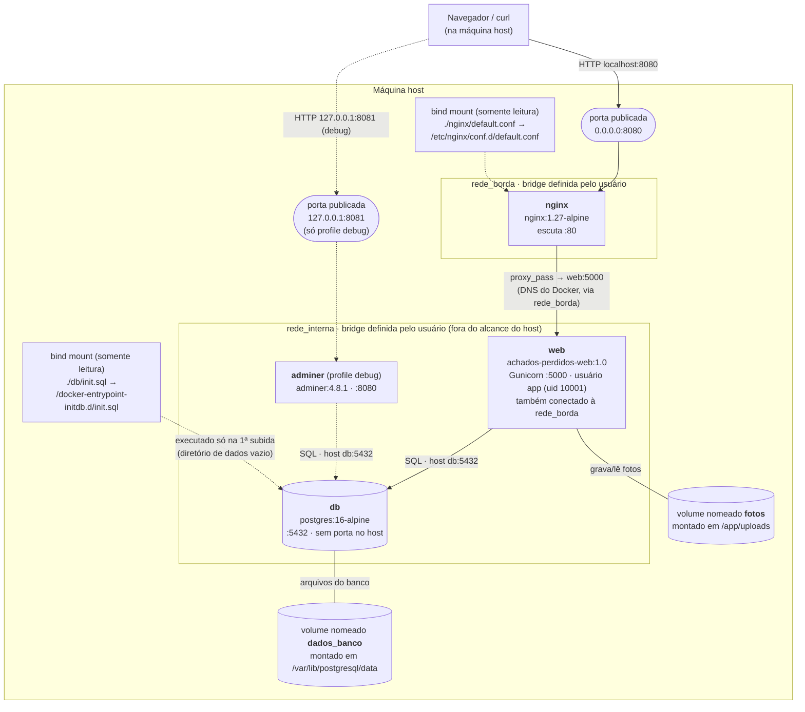

# Arquitetura: Achados & Perdidos (A2)

## Diagrama

## Quem fica dentro e fora de cada rede

| Contêiner | rede_borda | rede_interna | Porta no host | Observação |
|-----------|:----------:|:------------:|---------------|------------|
| nginx     | sim | **não** | `0.0.0.0:8080 → 80` | Único ponto de entrada. Não enxerga o banco. |
| web       | sim | sim | nenhuma (`expose: 5000`) | Faz a ponte entre o proxy e o banco. |
| db        | **não** | sim | nenhuma | Alcançável só por `web` e `adminer`, pelo nome `db`. |
| adminer   | não | sim | `127.0.0.1:8081 → 8080` | Só existe com `--profile debug` e só aceita conexões da própria máquina. |

## Armazenamento

| Recurso | Tipo | Origem (host) | Destino (contêiner) | Ciclo de vida |
|---------|------|---------------|---------------------|---------------|
| `fotos` | volume nomeado | gerenciado pelo Docker (`/var/lib/docker/volumes/achados-perdidos_fotos/_data` na VM) | `web:/app/uploads` | Sobrevive a `down`; apagado por `down -v`. |
| `dados_banco` | volume nomeado | gerenciado pelo Docker (`/var/lib/docker/volumes/achados-perdidos_dados_banco/_data`) | `db:/var/lib/postgresql/data` | Sobrevive a `down`; apagado por `down -v`. |
| `init.sql` | bind mount `:ro` | `./db/init.sql` (repositório) | `db:/docker-entrypoint-initdb.d/init.sql` | Versionado no Git; lido só quando o diretório de dados está vazio. |
| `default.conf` | bind mount `:ro` | `./nginx/default.conf` | `nginx:/etc/nginx/conf.d/default.conf` | Versionado no Git. |

## Relação com a arquitetura base do enunciado

O enunciado descreve `web` publicando `8080:5000`. Com o **bônus de proxy reverso**, o `web` deixou
de publicar portas e o nginx passou a ocupar a 8080 do host. A `rede_interna`
continua sendo a rede compartilhada por `web` e `db`, como exigido. A `rede_borda` foi acrescentada para
que o nginx, que é o serviço exposto, não tenha nenhuma rota até o PostgreSQL (defesa em profundidade).
As justificativas detalhadas estão em [RELATORIO.md](RELATORIO.md).
